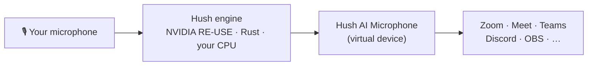

<p align="center">
  
</p>

<h1 align="center">Hush AI</h1>

<p align="center">
  <b>Silence the noise. Keep your voice.</b><br>
  Free, open-source noise cancellation for every app. It runs on your own computer.
</p>

<p align="center">
  <a href="https://github.com/alshell7/hush-ai/releases/latest"></a>
  <a href="https://github.com/alshell7/hush-ai/actions/workflows/ci.yml"></a>
  
  <a href="LICENSE"></a>
  <a href="https://huggingface.co/alshell7/hush-ai"></a>
</p>

<p align="center">
  <a href="https://github.com/alshell7/hush-ai/releases/latest"><b>Download</b></a> ·
  <a href="https://alshell7.github.io/hush-ai/"><b>Website</b></a> ·
  <a href="https://alshell7.github.io/hush-ai/#demo"><b>Hear the difference</b></a> ·
  <a href="docs/GUIDE.md"><b>User guide</b></a>
</p>

<p align="center">
  
</p>

Keyboards, fans, barking dogs, traffic, a busy café: **Hush AI removes them from your
microphone while you talk**. Apps hear only your voice through a new microphone called
**Hush AI Microphone**. Choose it in Zoom, Google Meet, Microsoft Teams, Discord, Slack,
OBS or any other app.

No account. No cloud. No subscription. Your voice never leaves your computer.

## Why Hush AI

|  |  |
| --- | --- |
| 🔒 **Private** | Everything runs on your CPU. Hush sends no audio, no telemetry and has no servers. |
| ⚡ **Real time** | 20 ms frames, about 60–80 ms from your microphone to your call. |
| 🪶 **Light** | Automatic threads use the fewest CPU cores that keep up. Windows "Pro Audio" priority keeps your voice smooth when the computer is busy. |
| 🎙️ **Works everywhere** | One virtual microphone for every app: Hush AI Microphone. |
| 🎯 **Proven quality** | NVIDIA's [Real-time RE-USE](https://huggingface.co/nvidia/Real-time_RE-USE) speech model with its original weights, in native Rust. The output matches NVIDIA's GPU reference at 113–118 dB. |
| 🧸 **Pleasant** | A calm app, a tray and menu bar widget, and updates that install themselves. |
| 🔓 **Open source** | Apache-2.0 app and engine. Read every line. |

## Hear the difference

NVIDIA's sample recording, before and after Hush AI (6.5 s):
[▶ Original](site/public/samples/noisy.mp3) · [▶ With Hush](site/public/samples/hush.mp3) ·
or try the [A/B player on the website](https://alshell7.github.io/hush-ai/#demo).

You can do the same with your own voice: the app's setup records a few seconds and plays
them back with and without Hush.

## Download

| Computer | Download |
| --- | --- |
| Windows 10 and 11 (x64) | [`…_x64-setup.exe`](https://github.com/alshell7/hush-ai/releases/latest) |
| Windows on ARM | [`…_arm64-setup.exe`](https://github.com/alshell7/hush-ai/releases/latest) |
| Mac with Apple silicon | [`…_aarch64.dmg`](https://github.com/alshell7/hush-ai/releases/latest) |
| Intel Mac (macOS 11+) | [`…_x64.dmg`](https://github.com/alshell7/hush-ai/releases/latest) |
| Linux (PipeWire or PulseAudio) | [`.AppImage`, `.deb`, `.rpm`](https://github.com/alshell7/hush-ai/releases/latest) |

The installers are small. On first start, Hush AI downloads the voice model (54 MB) from
[Hugging Face](https://huggingface.co/alshell7/hush-ai) and checks its SHA-256.

> [!NOTE]
> The apps are not code-signed yet, so Windows and macOS ask once before the first start.
> **Windows:** More info › Run anyway. **macOS:** right-click the app › Open, or
> System Settings › Privacy & Security › Open Anyway.

## Set up in two minutes

<p align="center">
  
</p>

1. **Open Hush AI.** It downloads the voice model and asks which microphone you use.
2. **Get the Hush AI Microphone.**
   - **macOS:** one click and your password. Hush installs its own small audio driver.
   - **Windows:** install the free [VB-CABLE](https://vb-audio.com/Cable/) by VB-Audio
     (Hush shows each step), then Hush renames it to *Hush AI Microphone*.
   - **Linux:** nothing to do. Hush creates it on PipeWire or PulseAudio.
3. **Hear the difference.** Record a few seconds and compare.
4. **Choose Hush AI Microphone in your apps:**

| App | Where |
| --- | --- |
| Zoom | Settings › Audio › Microphone |
| Google Meet | More options › Settings › Audio › Microphone |
| Microsoft Teams | Settings › Devices › Microphone |
| Discord | User Settings › Voice & Video › Input Device |
| Slack | Preferences › Audio & video › Microphone |
| OBS Studio | Settings › Audio › Mic/Auxiliary Audio |

Hush AI then lives in your tray (Windows, Linux) or menu bar (macOS). Click the mochi to
turn noise cancellation on or off, change the microphone or the quality.

## How it works



- The **engine** (`crates/hush-core`) runs the Mamba-based RE-USE model one 20 ms frame
  at a time, in plain Rust with SIMD. No Python, no GPU, no ONNX runtime.
- The **app** (`app/`, Tauri 2) opens your microphone, feeds the engine on a real-time
  thread and writes the clean voice to the virtual microphone. The model never runs in
  the audio callback, so a slow frame can never glitch the device.
- The **virtual microphone** (`virtual_mic/`) is Hush's Core Audio plug-in on macOS,
  VB-CABLE on Windows (Hush's own driver is built and waits for Microsoft signing), and a
  PipeWire/PulseAudio virtual source on Linux.

[Architecture](docs/ARCHITECTURE.md) has the details: threads, buffers, clock drift and the
delay budget.

## Performance

One frame is 20 ms of audio, so each frame must finish in less than 20 ms.

| Quality | Apple M1, 2 threads | Intel x64 (cloud), 4 threads |
| --- | ---: | ---: |
| **Light** (16 kHz, best for calls) | **11.7 ms** p99 | **17.1 ms** p99 |
| **Balanced** (24 kHz) | 21.3 ms p99 | 21.4 ms p99 |
| **Studio** (48 kHz, full band) | 36.8 ms p99 | 23.7 ms p99 (8 threads) |

- **Delay:** about 60–80 ms plus device buffers (VB-CABLE adds about 84 ms on Windows).
- **Memory:** 80–250 MB, mostly the model. It does not grow: 60 minutes with a USB headset
  gave 75.65 → 75.63 MB and no lost audio.
- **CPU:** the app shows the live engine load. Automatic threads add a core only when one
  is not enough.

[Performance](docs/PERFORMANCE.md) has every measurement and how to repeat it.

## Roadmap

- [x] **Noise cancellation**: real time, on device, in every app
- [ ] **Voice translation**
- [ ] **Agent assist**
- [ ] **Speech analytics**
- [ ] **Voice security**
- [ ] Hush's own signed Windows driver (lower delay than VB-CABLE)
- [ ] GPU and NPU acceleration

Want to help? Pick an item and open an issue. See [CONTRIBUTING.md](CONTRIBUTING.md).

## Build from source

You need [Rust](https://rustup.rs), [Node.js](https://nodejs.org) 20+ and the
[Tauri prerequisites](https://tauri.app/start/prerequisites/) for your system.

```sh
git clone https://github.com/alshell7/hush-ai.git
cd hush-ai/app
npm install
npm run tauri dev
```

The app downloads the model on first start. To run the engine tests, see
[Build and release](docs/BUILD.md).

## Use the engine in your own project

```rust
use hush_core::{Config, Denoiser};

let mut denoiser = Denoiser::with_config(
    "models/model.safetensors",
    Config { layers: 3, sample_rate: 16_000, look_ahead: 0 },
)?;
let mut clean = Vec::new();
denoiser.process_into(&noisy_chunk, &mut clean)?; // any chunk size, mono f32
```

`hush_core::live::LiveWorker` adds lock-free device queues, rate conversion, clock-drift
control and meters. [More](crates/hush-core/README.md).

## FAQ

<details>
<summary><b>Is it really free?</b></summary>

Yes. No account, no trial, no limits. The code is Apache-2.0.
</details>

<details>
<summary><b>Can I use it at work?</b></summary>

The app and the engine are Apache-2.0. The **voice model** is NVIDIA's and comes with the
[NVIDIA One-Way Noncommercial License](https://huggingface.co/alshell7/hush-ai/blob/main/LICENSE):
the weights are for **non-commercial research and educational use**. Hush AI asks you to
accept this before it downloads them. Check the license before you use Hush AI for
commercial work.
</details>

<details>
<summary><b>Does my voice leave my computer?</b></summary>

No. Hush AI connects to the internet only to download the model once and to check GitHub
for updates (you can turn this off).
</details>

<details>
<summary><b>Why VB-CABLE on Windows?</b></summary>

Windows loads audio drivers only with Microsoft's signature. Hush's own driver is built and
tested, and waits for that signature. Until then, VB-CABLE (free, signed, by VB-Audio)
carries the audio. Its license does not allow Hush to include it, so you install it once
yourself. Hush renames it so apps show *Hush AI Microphone*.
</details>

<details>
<summary><b>How do I uninstall?</b></summary>

Settings › Hush AI Microphone › Remove (macOS) or Restore VB-CABLE names (Windows), then
uninstall the app like any other. On Linux, the virtual microphone disappears when Hush
quits.
</details>

More in the [user guide](docs/GUIDE.md).

## Documentation

| Page | For |
| --- | --- |
| [User guide](docs/GUIDE.md) | Install, set up, use in apps, fix problems |
| [Architecture](docs/ARCHITECTURE.md) | How audio flows through Hush |
| [Performance](docs/PERFORMANCE.md) | CPU time, delay, long runs |
| [Accuracy](docs/ACCURACY.md) | Comparison with NVIDIA's GPU reference |
| [Virtual microphone](virtual_mic/README.md) | The drivers for macOS and Windows |
| [Build and release](docs/BUILD.md) | Develop, test, release |

## Credits

- [NVIDIA Real-time RE-USE](https://huggingface.co/nvidia/Real-time_RE-USE): the speech
  enhancement model and weights (NVIDIA One-Way Noncommercial License).
- [re-use-rs](https://github.com/altunenes/re-use-rs) by altunenes: the Rust port this
  engine grew from (MIT or Apache-2.0).
- Microsoft's [SysVAD sample](https://github.com/microsoft/Windows-driver-samples) (MS-PL)
  for the Windows driver, and Apple's Audio Server Plug-in design for macOS.
- [VB-CABLE](https://vb-audio.com/Cable/) by VB-Audio, the free virtual cable Hush uses on Windows.
- [Tauri](https://tauri.app), [HeroUI](https://heroui.com), [Motion](https://motion.dev) and the Geist font.

Hush AI is an independent open-source project. It is not affiliated with NVIDIA, VB-Audio
or any app named here.

## License

Code: [Apache-2.0](LICENSE). Third-party parts and the model: see [NOTICE](NOTICE).
