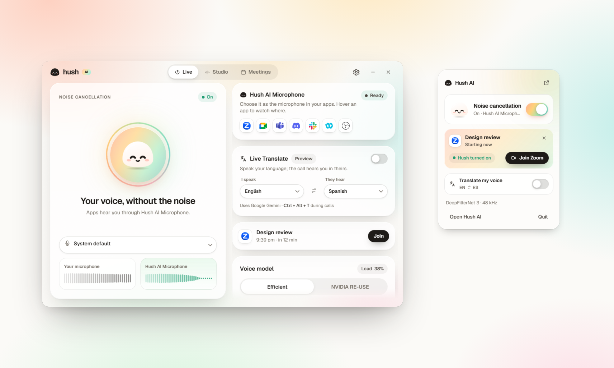
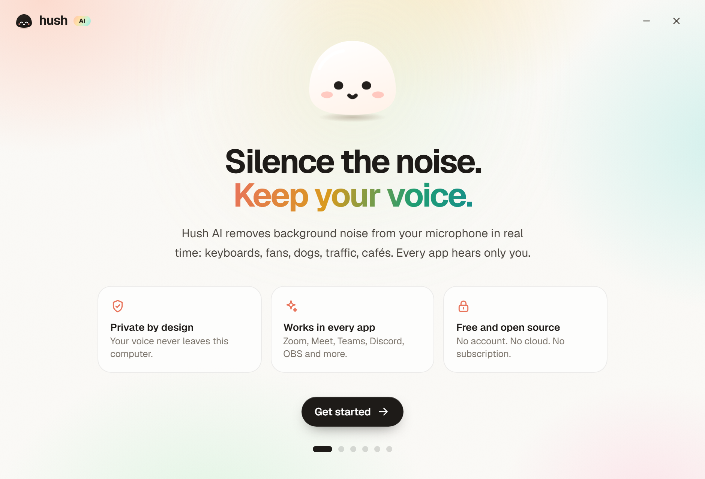
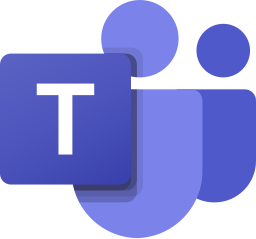
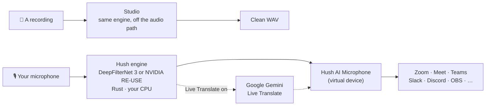

<p align="center">
  
</p>

<h1 align="center">Hush AI</h1>

<p align="center">
  <b>Silence the noise. Keep your voice.</b><br>
  The free, open-source alternative to Krisp for your calls and to Adobe Podcast for your recordings.<br>
  It runs on your own computer.
</p>

<p align="center">
  <a href="https://github.com/alshell7/hush-ai/releases/latest"></a>
  <a href="https://github.com/alshell7/hush-ai/actions/workflows/ci.yml"></a>
  
  <a href="LICENSE"></a>
  <a href="https://huggingface.co/alshell7/hush-ai"></a>
</p>

<p align="center">
  <a href="https://github.com/alshell7/hush-ai/releases/latest"><b>Download</b></a> ·
  <a href="https://alshell7.github.io/hush-ai/"><b>Website</b></a> ·
  <a href="https://alshell7.github.io/hush-ai/#demo"><b>Hear the difference</b></a> ·
  <a href="https://alshell7.github.io/hush-ai/docs/"><b>Docs</b></a>
</p>

<p align="center">
  
</p>

Keyboards, fans, barking dogs, traffic, a busy café, a crying baby. **Hush AI removes them
from your voice while you talk**, and from recordings you already have.

- **On calls**, apps hear you through a new microphone called **Hush AI Microphone**. Choose
  it once in Zoom, Google Meet, Microsoft Teams, Slack, Discord, Webex or OBS.
- **In Studio**, drop an audio or video file, or record yourself, and save a clean WAV.
- **With Google Calendar**, Hush turns itself on a minute before each call and pops up with a
  Join button. No Google sign-in.
- **With Live Translate** (Preview), you speak your language and the call hears you in
  theirs, through Google's Gemini Live Translate and your own API key.

No account. No subscription. No minute limits. Noise cancellation never leaves your computer.

## Why Hush AI

|  |  |
| --- | --- |
| 🔒 **On your computer** | Noise cancellation and Studio run on your CPU. Hush sends no telemetry and has no servers. |
| 🪶 **Light** | The default engine, DeepFilterNet 3, needs one thread: about 7% of a laptop core offline, 11–13% live. Your laptop stays cool and quiet. |
| ⚡ **Real time** | 10–20 ms frames, about 60 ms before device buffers. |
| 🎙️ **Works everywhere** | One virtual microphone for every app. A tray and menu bar widget to switch it on and off. |
| 🎚️ **Two engines** | DeepFilterNet 3 (light, the default) or NVIDIA Real-time RE-USE (most natural at high settings). Switch any time. |
| 📼 **Studio** | Clean up podcasts, voice notes, interviews and lectures. Drag and drop, compare before and after, save. |
| 📅 **Meetings** | Google Calendar through its private iCal address. Hush is ready before your call is. |
| 🌍 **Live Translate** | Preview. Pick "I speak" and "They hear" from 70+ languages; switch it in calls with Ctrl+Alt+T. The one feature that uses the cloud, and only while it is on. |
| 🔓 **Open source** | Apache-2.0 app and engine. Read every line. |

## Hush AI, Krisp and Adobe Podcast

|  | Hush AI | Krisp | Adobe Podcast Enhance Speech |
| --- | --- | --- | --- |
| **Price** | Free, no limits | 7-day free trial, then paid plans | Free with daily limits; more with a paid Adobe plan |
| **Open source** | Yes, Apache-2.0 | No | No |
| **Account** | None | Sign-up | Adobe account |
| **Where your audio is processed** | Your computer | Your computer (noise cancellation) | Adobe's servers: you upload the file |
| **Live calls in any app** | Yes | Yes | No |
| **Clean up recordings** | Yes, on your computer | – | Yes, in the browser |
| **Live voice translation** | Preview, through Google Gemini with your key | – | No |

From the vendors' public pages ([krisp.ai/pricing](https://krisp.ai/pricing/),
[podcast.adobe.com](https://podcast.adobe.com/en/plans)), November 2026; – means we did not
find it there. We have not measured Krisp's or Adobe's audio quality, so this table compares
what each product is, not how it sounds.

## Hear the difference

GitHub cannot play audio in this page. The website has an
[A/B player](https://alshell7.github.io/hush-ai/#demo) with everyday scenes (a dog, a
keyboard, a café, a street) where you switch between the original and Hush while it plays.

Or try your own voice: Hush's setup records a few seconds and plays them back with and
without Hush, and Studio cleans up any recording you drop on it.

## Download

| Computer | Download |
| --- | --- |
| Windows 10 and 11 (x64) | [`…_x64-setup.exe`](https://github.com/alshell7/hush-ai/releases/latest) |
| Windows on ARM | [`…_arm64-setup.exe`](https://github.com/alshell7/hush-ai/releases/latest) |
| Mac with Apple silicon | [`…_aarch64.dmg`](https://github.com/alshell7/hush-ai/releases/latest) |
| Intel Mac (macOS 11+) | [`…_x64.dmg`](https://github.com/alshell7/hush-ai/releases/latest) |
| Linux (PipeWire or PulseAudio) | [`.AppImage`, `.deb`, `.rpm`](https://github.com/alshell7/hush-ai/releases/latest) |

The installers are small. On first start, Hush AI downloads the voice model from
[Hugging Face](https://huggingface.co/alshell7/hush-ai) (8 MB for DeepFilterNet 3, 54 MB
for RE-USE) and checks its SHA-256. If Hugging Face is unreachable, it uses the model's
original source.

> [!NOTE]
> The apps are not code-signed yet, so Windows and macOS ask once before the first start.
> **Windows:** More info › Run anyway. **macOS:** right-click the app › Open, or
> System Settings › Privacy & Security › Open Anyway.

## Set up in two minutes

<p align="center">
  
</p>

1. **Open Hush AI.** It downloads the voice model and asks which microphone you use.
2. **Get the Hush AI Microphone.**
   - **macOS:** one click and your password. Hush installs its own small audio driver.
   - **Windows:** install the free [VB-CABLE](https://vb-audio.com/Cable/) by VB-Audio
     (Hush shows each step), then Hush renames it to *Hush AI Microphone*.
   - **Linux:** nothing to do. Hush creates it on PipeWire or PulseAudio.
3. **Hear the difference.** Record a few seconds and compare.
4. **Choose Hush AI Microphone in your apps.** Hover an app in Hush to watch where:

| | App | Where |
| --- | --- | --- |
|  | Zoom | Settings › Audio › Microphone |
|  | Google Meet | More options › Settings › Audio › Microphone |
|  | Microsoft Teams | Settings › Devices › Microphone |
|  | Slack | Preferences › Audio & video › Microphone |
|  | Discord | User Settings › Voice & Video › Input Device |
|  | Webex | Settings › Audio › Microphone |
|  | OBS Studio | Settings › Audio › Mic/Auxiliary Audio |

Hush AI then lives in your tray (Windows, Linux) or menu bar (macOS). Click the mochi to
turn noise cancellation on or off, change the microphone, or join your next meeting.

### Studio: clean up a recording

Open the **Studio** tab and drop a file: WAV, MP3, M4A/AAC, FLAC, OGG, or the sound of an
MP4 or MOV. Or press **Record yourself**. Hush cleans it with the engine you chose, shows
both waveforms, and lets you switch between the original and the clean version while it
plays. **Save clean WAV** writes a 48 kHz file wherever you like. Long files are fine: Hush
reads and writes them in pieces, so memory stays flat.

### Live Translate: be heard in their language

1. On the **Live** tab, press **Add your Gemini API key**. Hush opens
   [Google AI Studio](https://aistudio.google.com/apikey); press **Create API key** and copy
   it. Back in Hush, the key is noticed, checked with Google and kept in Hush's settings
   folder.
2. Choose **I speak** and **They hear**; ⇄ swaps them.
3. Turn on **Live Translate**. Your apps hear the translated voice through Hush AI
   Microphone, and captions show what you said and what they hear.

In a call, switch it from the tray widget, the tray menu (**Translate my voice**) or with
**Ctrl + Alt + T** (**⌘ ⌥ T** on macOS). While it is on, your noise-cancelled voice goes to
Google's `gemini-3.5-live-translate-preview` model; Google's terms and pricing apply to your
key (there is a free tier). The translation follows you by a phrase or so.

### Meetings: Google Calendar without signing in

Open the **Meetings** tab and press **Connect Google Calendar**:

1. **Open settings** takes you to Google Calendar's settings.
2. Under *Settings for my calendars*, pick your calendar, then **Integrate calendar**.
3. Copy **Secret address in iCal format**.

Come back to Hush: it notices the address on the clipboard, checks it with Google, and
shows the calendar's name and how many meetings it found. Press **Connect**. Then choose:

- how often Hush checks for changes (5, 15, 30 or 60 minutes);
- whether it turns noise cancellation on 1, 2 or 5 minutes before a call with a Meet, Zoom,
  Teams, Webex, Slack or Discord link, and off again afterwards;
- whether the tray widget pops up with a Join button.

The address stays in Hush's settings folder on your computer. Hush reads it straight from
Google; there is no Hush server and no Google sign-in. Anyone with the address can read
your calendar, so Google lets you reset it any time, and **Disconnect** makes Hush forget it.

## How it works



- The **engine** (`crates/hush-core`) runs either model one frame at a time on the CPU:
  NVIDIA's Mamba-based RE-USE in plain Rust with SIMD (20 ms frames), or DeepFilterNet 3
  through its official Rust inference (10 ms frames). No Python, no GPU.
- The **app** (`app/`, Tauri 2) opens your microphone, feeds the engine on its own thread
  and writes the clean voice to the virtual microphone. The model never runs in the audio
  callback, so a slow frame can never glitch the device.
- The **virtual microphone** (`virtual_mic/`) is Hush's Core Audio plug-in on macOS,
  VB-CABLE on Windows (Hush's own driver is built and waits for Microsoft signing), and a
  PipeWire/PulseAudio virtual source on Linux.

[Architecture](docs/ARCHITECTURE.md) has the details: threads, buffers, clock drift and the
delay budget.

## How it compares

Hush's two engines against RNNoise, the open-source suppressor many apps use, on the
VoiceBank-DEMAND test set (824 recordings, scored at 16 kHz). Higher is better; **bold** is
the best.

| System | PESQ | STOI | SI-SDR | DNSMOS OVRL | CPU per audio second (1 thread) |
| --- | ---: | ---: | ---: | ---: | ---: |
| No noise removal | 1.97 | 0.921 | 8.4 dB | 2.70 | – |
| RNNoise | 2.11 | 0.890 | 12.3 dB | 2.94 | 5% |
| **Hush · DeepFilterNet 3** (default) | **3.10** | **0.945** | **19.0 dB** | 3.18 | 7% |
| Hush · NVIDIA RE-USE, Light (16 kHz, 3 layers) | 2.61 | 0.934 | 18.0 dB | 3.16 | 79% |
| Hush · NVIDIA RE-USE, 8 layers | 2.77 | 0.938 | 18.5 dB | **3.23** | 146% |

- **Hush leads every metric.** DeepFilterNet 3 has the best PESQ, STOI and SI-SDR at about
  7% of a core; RE-USE with 8 layers has the most natural sound by DNSMOS. CPU figures are
  rough: the laptop was doing other work.
- **Why two engines:** DeepFilterNet 3 is light and accurate, so it is the default. RE-USE
  needs a faster CPU, for people who want its sound.
- **Both are reproduced faithfully.** Hush's RE-USE matches NVIDIA's published PESQ (2.77
  against 2.76) and NVIDIA's GPU output at 100+ dB. DeepFilterNet 3 runs the authors'
  own libDF code and model.
- **Caveats:** one dataset, objective metrics only, no listening test. The test speech is
  VCTK and the noise is DEMAND, which is close to DeepFilterNet 3's training data.

[Comparison](docs/COMPARISON.md) has the method, all metrics, results by noise level, delays
and the script to repeat it. [Performance](docs/PERFORMANCE.md) has frame times, delay and
long runs.

## Roadmap

- [x] **Noise cancellation**: real time, on device, in every app
- [x] **Studio**: clean up recordings on your computer
- [x] **Meetings**: Google Calendar without signing in
- [x] **Voice translation**: Live Translate (Preview), through Google Gemini
- [ ] **Agent assist**
- [ ] **Speech analytics**
- [ ] **Voice security**
- [ ] Hush's own signed Windows driver (lower delay than VB-CABLE)

Want to help? Pick an item and open an issue. See [CONTRIBUTING.md](CONTRIBUTING.md).

## Build from source

You need [Rust](https://rustup.rs), [Node.js](https://nodejs.org) 20+ and the
[Tauri prerequisites](https://tauri.app/start/prerequisites/) for your system.

```sh
git clone https://github.com/alshell7/hush-ai.git
cd hush-ai/app
npm install
npm run tauri dev
```

The app downloads the model on first start. To run the engine tests, see
[Build and release](docs/BUILD.md).

## Use the engine in your own project

```rust
use hush_core::{Config, Denoiser};

let mut denoiser = Denoiser::with_config(
    "models/model.safetensors",
    Config { layers: 3, sample_rate: 16_000, look_ahead: 0 },
)?;
let mut clean = Vec::new();
denoiser.process_into(&noisy_chunk, &mut clean)?; // any chunk size, mono f32
```

`hush_core::DeepFilter` offers DeepFilterNet 3 behind the same interface, and
`hush_core::live::LiveWorker` adds lock-free device queues, rate conversion, clock-drift
control and meters for either. [More](crates/hush-core/README.md).

## FAQ

<details>
<summary><b>Is it really free?</b></summary>

Yes. No account, no trial, no minute limits. The code is Apache-2.0.
</details>

<details>
<summary><b>Can I use it at work?</b></summary>

Yes. Hush AI and its default engine, DeepFilterNet 3, are open source (Apache-2.0 and MIT).
The optional NVIDIA engine has its own license terms, which Hush shows before it downloads
that model. See [License](#license).
</details>

<details>
<summary><b>Does my voice leave my computer?</b></summary>

Not for noise cancellation or Studio: they run on your computer. Hush connects to the
internet to download a model once, to check GitHub for updates (you can turn this off), to
read your calendar's iCal address if you connect one, and, **only while Live Translate is
on**, to send your voice to Google for translation.
</details>

<details>
<summary><b>Is the calendar address safe in Hush?</b></summary>

It is stored only in Hush's settings folder on your computer and never written to logs.
Hush never sees your Google account. Like any secret link, anyone who has it can read the
calendar, so reset it in Google Calendar if it leaks; Hush shows how to connect again.
</details>

<details>
<summary><b>Why VB-CABLE on Windows?</b></summary>

Windows loads audio drivers only with Microsoft's signature. Hush's own driver is built and
tested, and waits for that signature. Until then, VB-CABLE (free, signed, by VB-Audio)
carries the audio. Its license does not allow Hush to include it, so you install it once
yourself. Hush renames it so apps show *Hush AI Microphone*.
</details>

<details>
<summary><b>How do I uninstall?</b></summary>

Settings › Hush AI Microphone › Remove (macOS) or Restore VB-CABLE names (Windows), then
uninstall the app like any other. On Linux, the virtual microphone disappears when Hush
quits.
</details>

More in the [user guide](docs/GUIDE.md).

## Documentation

All docs are also on the website at [alshell7.github.io/hush-ai/docs](https://alshell7.github.io/hush-ai/docs/).

| Page | For |
| --- | --- |
| [User guide](docs/GUIDE.md) | Install, set up, use in apps, Studio, Meetings, fix problems |
| [Architecture](docs/ARCHITECTURE.md) | How audio flows through Hush |
| [Performance](docs/PERFORMANCE.md) | CPU time, delay, long runs |
| [Accuracy](docs/ACCURACY.md) | Comparison with NVIDIA's GPU reference |
| [Comparison](docs/COMPARISON.md) | Hush's engines vs RNNoise, measured |
| [Virtual microphone](virtual_mic/README.md) | The drivers for macOS and Windows |
| [Build and release](docs/BUILD.md) | Develop, test, release |

## Credits

- [DeepFilterNet](https://github.com/Rikorose/DeepFilterNet) by Hendrik Schröter: the
  DeepFilterNet 3 model and its Rust inference (MIT or Apache-2.0).
- [NVIDIA Real-time RE-USE](https://huggingface.co/nvidia/Real-time_RE-USE): the speech
  enhancement model and weights.
- [re-use-rs](https://github.com/altunenes/re-use-rs) by altunenes: the Rust port this
  engine grew from (MIT or Apache-2.0).
- Microsoft's [SysVAD sample](https://github.com/microsoft/Windows-driver-samples) (MS-PL)
  for the Windows driver, and Apple's Audio Server Plug-in design for macOS.
- [VB-CABLE](https://vb-audio.com/Cable/) by VB-Audio, the free virtual cable Hush uses on Windows.
- [Symphonia](https://github.com/pdeljanov/Symphonia) for reading audio files,
  [rrule](https://github.com/fmeringdal/rust-rrule) for repeating calendar events, and
  [tungstenite](https://github.com/snapview/tungstenite-rs) for the Gemini Live connection.
- [Google Gemini 3.5 Live Translate](https://aistudio.google.com/docs/live-api/live-translate),
  the cloud model behind Live Translate (with your own key).
- App logos from [gilbarbara/logos](https://github.com/gilbarbara/logos) and
  [Simple Icons](https://simpleicons.org) (CC0). The names and logos belong to their owners.
- [Tauri](https://tauri.app), [HeroUI](https://heroui.com), [Motion](https://motion.dev) and the Geist font.

Hush AI is an independent open-source project. It is not affiliated with or endorsed by
NVIDIA, the DeepFilterNet authors, VB-Audio, Krisp, Adobe, Google or any app named here.

## License

- **Hush AI** (app, engine, drivers): [Apache-2.0](LICENSE).
- **DeepFilterNet 3** model and inference: MIT or Apache-2.0, by Hendrik Schröter.
- **NVIDIA Real-time RE-USE** weights: the
  [NVIDIA One-Way Noncommercial License](https://huggingface.co/alshell7/hush-ai/blob/main/LICENSE),
  for non-commercial research and educational use; NVIDIA and its affiliates may use them
  commercially. Hush downloads them only after you agree to those terms.

Other third-party parts: see [NOTICE](NOTICE).
