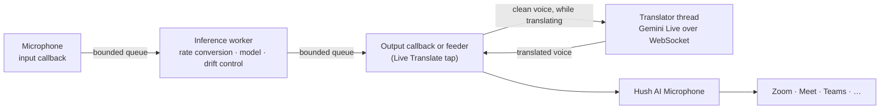
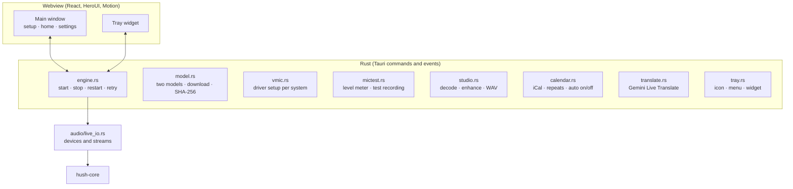

# Architecture

[Home](../README.md) · [Guide](GUIDE.md) · [Performance](PERFORMANCE.md) · [Accuracy](ACCURACY.md) · [Build](BUILD.md)

Hush AI has three parts:

| Part | Folder | Language |
| --- | --- | --- |
| Engine: the speech model and the live audio worker | [`crates/hush-core`](../crates/hush-core) | Rust |
| App: windows, tray, devices, setup, updates | [`app`](../app) (Tauri 2) | Rust + React |
| Virtual microphone drivers | [`virtual_mic`](../virtual_mic) | C / C++ |

The engine runs one of two voice models, chosen in the app. Both run on the CPU, without
Python, GPU or network:

| Model | Code | Rate | Frame | Threads | License of the weights |
| --- | --- | --- | --- | --- | --- |
| **DeepFilterNet 3** (default) | libDF 0.5.6 with tract, the same Rust code as the official `deep-filter` command | 48 kHz | 10 ms | 1 | MIT or Apache-2.0 |
| **NVIDIA Real-time RE-USE** | Hush's own Rust port, FP32, NVIDIA's weights without change | 16–48 kHz (Light, Balanced, Studio) | 20 ms | Automatic or fixed | NVIDIA One-Way Noncommercial |

Both implement `hush_core::Enhancer`, the streaming interface that the live worker drives.

## Live audio path

| Thread | Work | Rules |
| --- | --- | --- |
| Windows (webview) | Controls, meters, setup | Never touches devices directly |
| Control thread | Finds devices, loads the model, starts and stops streams | Blocking device calls stay here |
| Input callback | Converts and down-mixes samples into a bounded queue | No allocation, lock or inference. A full queue drops samples and counts them |
| Inference worker | Rate conversion, framing, model, output queue | Owns all model and filter state. DeepFilterNet 3 runs here, on this thread only |
| Rayon workers | Parallel CPU kernels of RE-USE | **Automatic** (default) or a fixed count |
| Output callback | Reads samples, fades gaps to silence, applies the Live Translate tap | No allocation, lock or waiting |
| Virtual microphone feeder | Moves output into the driver's ring buffer (macOS) | Real-time priority; 2 ms period |
| Translator | Only while Live Translate is on: sends 100 ms of 16 kHz voice to Gemini, plays its 24 kHz answer | Off the audio path; talks to the tap through two lock-free queues |

### Workers and priority

DeepFilterNet 3 needs one thread, so it uses no worker pool. For RE-USE, **Automatic** threads measure the computer when noise cancellation starts. The worker tries
1, 2, 3 … threads for about 30 frames each and keeps the fewest that finish a frame in 60%
of its time. It stops early when one more thread cuts the frame time by less than 10%,
because each thread adds CPU use. While running, it adds a thread after one second above
75% load, removes it again if it does not cut the load by 10%, and removes added threads
after 30 seconds below 40% load.

On Windows, **Audio priority** (on by default) registers the inference threads with the
Windows audio scheduler (MMCSS), so busy programs do not interrupt them. On macOS, the
inference threads use the user-interactive QoS class (performance cores, no timer
coalescing). The virtual microphone feeder uses MMCSS on Windows and the Mach real-time
policy on macOS (`hush_core::audio_thread`).

The model rate and the device rates are independent: a 48 kHz headset can use the 16 kHz
model, and DeepFilterNet 3 always runs at 48 kHz. The worker converts the rates. A bounded
output-rate correction (±1000 ppm) follows
the drift between the input and output clocks.

An input gap resets the model, the filters and the drift controller. The output discards
samples from before the reset and fades for 5 ms.

### Delay budget

| Part | RE-USE (20 ms frames) | DeepFilterNet 3 (10 ms frames) |
| --- | --- | --- |
| Frame collection | 20 ms | 10 ms |
| Model delay | 20 ms (analysis window) | 30 ms (window and 2 frames of look-ahead) |
| Output prefill | 20 ms (1 frame) | 20 ms (2 frames) |
| Rate conversion | 16 samples per conversion | 16 samples per conversion |
| Device buffers | Set by the operating system and the driver | Same |

Both models add about 60 ms before device buffers. The prefill is at least 20 ms for both,
so device callbacks of 10 ms or more do not drain it. VB-CABLE on Windows adds about 84 ms
more; the Hush drivers read 10 ms behind the newest sample.

### Meters and A/B

The worker counts frame time, peaks, drops and underruns with lock-free atomics. The app
reads them 20 times per second, only while a window that shows them is visible. **Load** is
the share of real time the worker needs for its frames: below 100% it keeps up.

### Live Translate tap

Each live session creates a tap with two lock-free queues and shares one flag with the
translator. While the flag is off, the tap does nothing. While it is on, the output callback
pushes the clean voice into one queue and plays the translated voice from the other,
silence when nothing has arrived yet. The translator thread resamples to 16 kHz, sends
100 ms messages to `gemini-3.5-live-translate-preview` over the Live API WebSocket, decodes
the 24 kHz answer and resamples it to the device rate. It keeps a session-resumption handle,
so it continues on a new connection when Google rotates the old one (about every 10
minutes), and reconnects with a new setup when the target language changes.

Noise cancellation off never silences Hush AI Microphone. The engine then runs a
pass-through session (`bypass`) with a model-free enhancer: the worker copies the microphone
to the output unchanged, so apps keep hearing the user (and Live Translate's tap works as
usual), and the tray shows noise cancellation as off. Turning noise cancellation on or off
restarts the session in the other mode; only quitting Hush stops it.

The translator joins the captions of one phrase (until a 2.5-second pause) into a line with
both languages and hands it to the conversations (see Conversations), unless the user turned
them off. Their voice works the same way through the listener's tap.

## Their voice: the listener

`listen.rs` keeps one thread that owns the streams for the other side's voice (cpal streams
are not `Send`):

- **Hush AI Speaker mode.** The meeting app plays to a virtual speaker: the Core Audio
  plug-in's speaker ring on macOS (`hush_core::virtual_speaker`), a PulseAudio null sink on
  Linux, or a render endpoint named "Hush AI Speaker" / VB-CABLE A or B on Windows, read by
  WASAPI loopback. Hush resamples to 48 kHz, cleans with DeepFilterNet 3 (attenuation limit
  12 dB for Light, 100 dB for Full), and plays it on the real output through a small queue
  that drops the excess beyond 80 ms, so their voice stays in step with the video.
- **Listening along.** Without a virtual speaker, Hush captures what the speakers play
  (WASAPI loopback, or the default sink's monitor) for translation only, and only while their
  voice is translated.

The capture callback only queues samples; one loop does the rest. Their voice feeds a
translation tap like yours (`translate::tap`); with Voice-over, their voice ducks to 22% in
about 40 ms while the translation speaks and comes back over 400 ms.

## Conversations

`conversation.rs` keeps every finished phrase (both sides, both languages) in threads. A
thread is one calendar meeting (`Calendar::current`) or one stretch of talk: a pause of 10
minutes or a different meeting starts a new one. Up to 500 threads and 40,000 lines are kept
in `conversations.json`, written at most every 3 seconds, starred threads last. Version 1.1's
`translate-history.json` is moved in on first read. Export renders Markdown, text or JSON.

## The notch

`notch.rs` creates one transparent, always-on-top window at the top centre of the main
screen; on macOS it sits above the menu bar on every Space (`NSWindow` level 25) and measures
the camera notch (`safeAreaInsets`, `auxiliaryTopLeftArea`). The page reports the island's
rectangle; a thread polls the cursor (every 40–60 ms, only while the window shows), passes
clicks through outside the island (`set_ignore_cursor_events`) and tells the page when the
cursor is near. `set_content_protected` keeps the windows out of screen captures when asked.

## App

- **One session at a time.** A change of microphone, model or quality restarts the session after
  the old one has released its devices. The Hush drivers accept one writer, so the new
  session never races the old one.
- **Recovery.** If a device disappears, the engine retries after 2, 4 and 8 seconds, then
  every 15 seconds, while noise cancellation is on. A missing microphone falls back to the
  system default and says so.
- **Low idle cost.** Meters stop when no window shows them. Animations are CSS transforms
  and stop when the window is hidden. The window has no work to do while you are in a call.
- **The models** are downloaded once, hashed while they download and kept only when the
  SHA-256 matches. DeepFilterNet 3 (8 MB) comes from the Hugging Face mirror, then the
  DeepFilterNet repository at tag v0.5.6. RE-USE (54 MB) comes from the Hugging Face mirror, then
  NVIDIA's pinned revision. Settings from Hush AI 1.0 keep RE-USE; new installs start with
  DeepFilterNet 3.
- **Studio** decodes files with Symphonia, mixes them to mono and converts them to 48 kHz
  in a streaming pipeline, runs the chosen model off the audio path, and writes the original
  and the result as WAV files into the app's cache folder for playback. Memory stays flat
  for long files.
- **Calendar** reads each iCal address (up to 12) every few minutes, expands repeating
  events (with `rrule`), moved and cancelled occurrences, and finds call links. It merges the
  calendars into one list: a meeting with the same event id, or the same title and times, is
  one meeting that remembers every calendar it came from. One calendar failing does not stop
  the others. A 10-second tick turns noise cancellation on before a call and pops up the
  widget, once per meeting.
- **Updates** come from GitHub Releases. Each update is signed; the app checks the
  signature before it installs.
- **Single instance.** A second start shows the running window.

## Virtual microphone

The driver only copies audio from a ring buffer; the model stays in the app. Reads are
indexed by the device clock, so several apps can record at once, and the driver plays
silence when Hush stops. See [virtual_mic](../virtual_mic/README.md).

| System | Driver | Setup |
| --- | --- | --- |
| macOS | Hush Core Audio plug-in, POSIX shared memory | One password prompt |
| Windows | VB-CABLE, renamed by Hush (Hush's SysVAD driver waits for signing) | Install VB-CABLE once, then one UAC prompt |
| Linux | `module-null-sink` + `module-remap-source` through `pactl` | None |

## Engine

| Part | Implementation |
| --- | --- |
| Matrix products | Prepacked weights; AVX-512 or AVX2 at runtime, portable fallback; Accelerate on macOS |
| FFT | `realfft`, plans reused |
| Mamba scans | Fused CPU scans, workspaces reused across layers |
| Normalization and convolution | Scratch buffers reused per call |

Source map

| Component | Source |
| --- | --- |
| Tauri commands, start-up, windows | [lib.rs](../app/src-tauri/src/lib.rs) |
| Engine control and meters | [engine.rs](../app/src-tauri/src/engine.rs) |
| Live devices and callbacks | [live_io.rs](../app/src-tauri/src/audio/live_io.rs) |
| Test recording and playback | [audio_io.rs](../app/src-tauri/src/audio/audio_io.rs), [mictest.rs](../app/src-tauri/src/mictest.rs) |
| VB-CABLE rename (Windows) | [vb_cable.rs](../app/src-tauri/src/audio/vb_cable.rs) |
| Queues, worker, meters, A/B | [live.rs](../crates/hush-core/src/live.rs) |
| Clock drift control | [live_drift.rs](../crates/hush-core/src/live_drift.rs) |
| Rate conversion | [resample.rs](../crates/hush-core/src/resample.rs) |
| Streaming wrapper, automatic workers | [denoiser.rs](../crates/hush-core/src/denoiser.rs) |
| Virtual microphone (app side) | [virtual_mic.rs](../crates/hush-core/src/virtual_mic.rs) |
| Model and kernels | [realtime.rs](../crates/hush-core/src/realtime.rs), [layers.rs](../crates/hush-core/src/layers.rs), [packed.rs](../crates/hush-core/src/packed.rs), [ops.rs](../crates/hush-core/src/ops.rs) |
| Frontend | [app/src](../app/src) |

