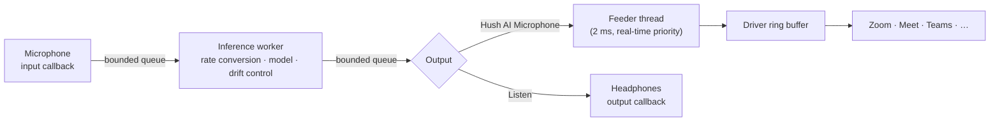
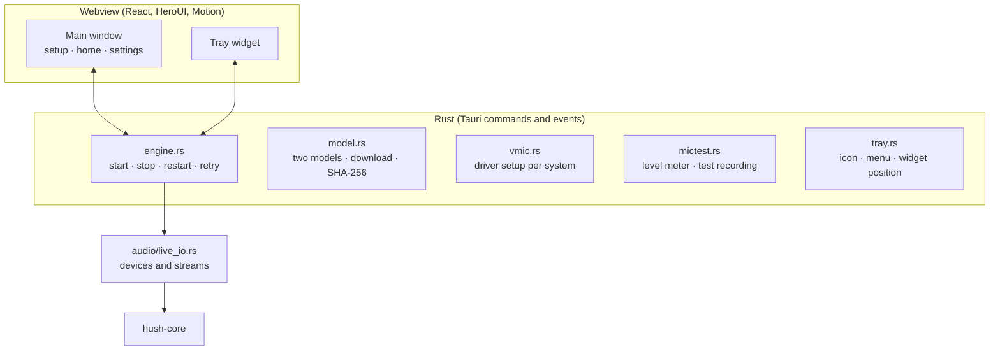

# Architecture

[Home](../README.md) · [Guide](GUIDE.md) · [Performance](PERFORMANCE.md) · [Accuracy](ACCURACY.md) · [Build](BUILD.md)

Hush AI has three parts:

| Part | Folder | Language |
| --- | --- | --- |
| Engine: the speech model and the live audio worker | [`crates/hush-core`](../crates/hush-core) | Rust |
| App: windows, tray, devices, setup, updates | [`app`](../app) (Tauri 2) | Rust + React |
| Virtual microphone drivers | [`virtual_mic`](../virtual_mic) | C / C++ |

The engine runs one of two voice models, chosen in the app. Both run on the CPU, without
Python, GPU or network:

| Model | Code | Rate | Frame | Threads | License of the weights |
| --- | --- | --- | --- | --- | --- |
| **DeepFilterNet 3** (default) | libDF 0.5.6 with tract, the same Rust code as the official `deep-filter` command | 48 kHz | 10 ms | 1 | MIT or Apache-2.0 |
| **NVIDIA Real-time RE-USE** | Hush's own Rust port, FP32, NVIDIA's weights without change | 16–48 kHz (Light, Balanced, Studio) | 20 ms | Automatic or fixed | NVIDIA One-Way Noncommercial |

Both implement `hush_core::Enhancer`, the streaming interface that the live worker drives.

## Live audio path

| Thread | Work | Rules |
| --- | --- | --- |
| Windows (webview) | Controls, meters, setup | Never touches devices directly |
| Control thread | Finds devices, loads the model, starts and stops streams | Blocking device calls stay here |
| Input callback | Converts and down-mixes samples into a bounded queue | No allocation, lock or inference. A full queue drops samples and counts them |
| Inference worker | Rate conversion, framing, model, output queue | Owns all model and filter state. DeepFilterNet 3 runs here, on this thread only |
| Rayon workers | Parallel CPU kernels of RE-USE | **Automatic** (default) or a fixed count |
| Output callback | Reads samples, fades gaps to silence | No allocation, lock or waiting |
| Virtual microphone feeder | Moves output into the driver's ring buffer | Real-time priority; 2 ms period |

### Workers and priority

DeepFilterNet 3 needs one thread, so it uses no worker pool. For RE-USE, **Automatic** threads measure the computer when noise cancellation starts. The worker tries
1, 2, 3 … threads for about 30 frames each and keeps the fewest that finish a frame in 60%
of its time. It stops early when one more thread cuts the frame time by less than 10%,
because each thread adds CPU use. While running, it adds a thread after one second above
75% load, removes it again if it does not cut the load by 10%, and removes added threads
after 30 seconds below 40% load.

On Windows, **Audio priority** (on by default) registers the inference threads with the
Windows audio scheduler (MMCSS), so busy programs do not interrupt them. On macOS, the
inference threads use the user-interactive QoS class (performance cores, no timer
coalescing). The virtual microphone feeder uses MMCSS on Windows and the Mach real-time
policy on macOS (`hush_core::audio_thread`).

The model rate and the device rates are independent: a 48 kHz headset can use the 16 kHz
model, and DeepFilterNet 3 always runs at 48 kHz. The worker converts the rates. A bounded
output-rate correction (±1000 ppm) follows
the drift between the input and output clocks.

An input gap resets the model, the filters and the drift controller. The output discards
samples from before the reset and fades for 5 ms.

### Delay budget

| Part | RE-USE (20 ms frames) | DeepFilterNet 3 (10 ms frames) |
| --- | --- | --- |
| Frame collection | 20 ms | 10 ms |
| Model delay | 20 ms (analysis window) | 30 ms (window and 2 frames of look-ahead) |
| Output prefill | 20 ms (1 frame) | 20 ms (2 frames) |
| Rate conversion | 16 samples per conversion | 16 samples per conversion |
| Device buffers | Set by the operating system and the driver | Same |

Both models add about 60 ms before device buffers. The prefill is at least 20 ms for both,
so device callbacks of 10 ms or more do not drain it. VB-CABLE on Windows adds about 84 ms
more; the Hush drivers read 10 ms behind the newest sample.

### Meters and A/B

The worker counts frame time, peaks, drops and underruns with lock-free atomics. The app
reads them 20 times per second, only while a window that shows them is visible. **Load** is
the share of real time the worker needs for its frames: below 100% it keeps up.

**Listen to yourself** sends the output to headphones instead of the Hush AI Microphone.
The **Original / With Hush** switch plays the input delayed by the model delay, so both
stay aligned and switching is seamless.

## App

- **One session at a time.** A change of microphone, model or quality restarts the session after
  the old one has released its devices. The Hush drivers accept one writer, so the new
  session never races the old one.
- **Recovery.** If a device disappears, the engine retries after 2, 4 and 8 seconds, then
  every 15 seconds, while noise cancellation is on. A missing microphone falls back to the
  system default and says so.
- **Low idle cost.** Meters stop when no window shows them. Animations are CSS transforms
  and stop when the window is hidden. The window has no work to do while you are in a call.
- **The models** are downloaded once, hashed while they download and kept only when the
  SHA-256 matches. DeepFilterNet 3 (8 MB) comes from the Hugging Face mirror, then the
  DeepFilterNet repository at tag v0.5.6. RE-USE (54 MB) comes from the Hugging Face mirror, then
  NVIDIA's pinned revision. Settings from Hush AI 1.0 keep RE-USE; new installs start with
  DeepFilterNet 3.
- **Updates** come from GitHub Releases. Each update is signed; the app checks the
  signature before it installs.
- **Single instance.** A second start shows the running window.

## Virtual microphone

The driver only copies audio from a ring buffer; the model stays in the app. Reads are
indexed by the device clock, so several apps can record at once, and the driver plays
silence when Hush stops. See [virtual_mic](../virtual_mic/README.md).

| System | Driver | Setup |
| --- | --- | --- |
| macOS | Hush Core Audio plug-in, POSIX shared memory | One password prompt |
| Windows | VB-CABLE, renamed by Hush (Hush's SysVAD driver waits for signing) | Install VB-CABLE once, then one UAC prompt |
| Linux | `module-null-sink` + `module-remap-source` through `pactl` | None |

## Engine

| Part | Implementation |
| --- | --- |
| Matrix products | Prepacked weights; AVX-512 or AVX2 at runtime, portable fallback; Accelerate on macOS |
| FFT | `realfft`, plans reused |
| Mamba scans | Fused CPU scans, workspaces reused across layers |
| Normalization and convolution | Scratch buffers reused per call |

Source map

| Component | Source |
| --- | --- |
| Tauri commands, start-up, windows | [lib.rs](../app/src-tauri/src/lib.rs) |
| Engine control and meters | [engine.rs](../app/src-tauri/src/engine.rs) |
| Live devices and callbacks | [live_io.rs](../app/src-tauri/src/audio/live_io.rs) |
| Test recording and playback | [audio_io.rs](../app/src-tauri/src/audio/audio_io.rs), [mictest.rs](../app/src-tauri/src/mictest.rs) |
| VB-CABLE rename (Windows) | [vb_cable.rs](../app/src-tauri/src/audio/vb_cable.rs) |
| Queues, worker, meters, A/B | [live.rs](../crates/hush-core/src/live.rs) |
| Clock drift control | [live_drift.rs](../crates/hush-core/src/live_drift.rs) |
| Rate conversion | [resample.rs](../crates/hush-core/src/resample.rs) |
| Streaming wrapper, automatic workers | [denoiser.rs](../crates/hush-core/src/denoiser.rs) |
| Virtual microphone (app side) | [virtual_mic.rs](../crates/hush-core/src/virtual_mic.rs) |
| Model and kernels | [realtime.rs](../crates/hush-core/src/realtime.rs), [layers.rs](../crates/hush-core/src/layers.rs), [packed.rs](../crates/hush-core/src/packed.rs), [ops.rs](../crates/hush-core/src/ops.rs) |
| Frontend | [app/src](../app/src) |

